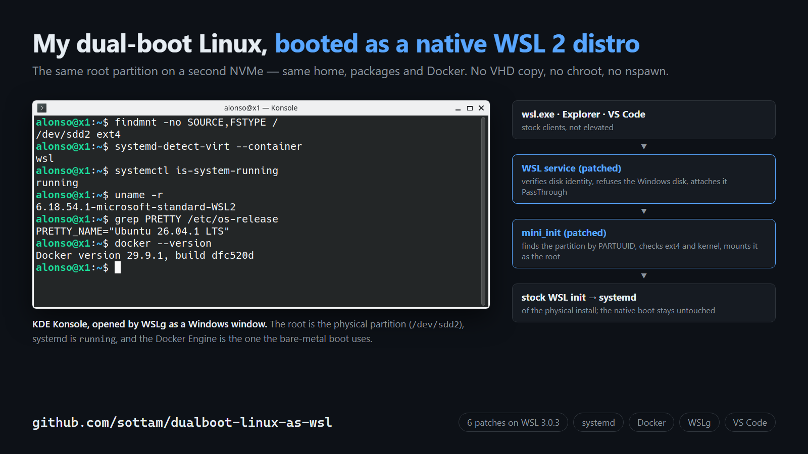

# dualboot-linux-as-wsl

**Rode no WSL 2, como distro nativa, o mesmo Linux que você já tem instalado em dual boot
num segundo disco — a mesma partição raiz, a mesma home, os mesmos pacotes e o mesmo Docker.
Sem copiar para VHD, sem chroot, sem nspawn.**

[English](README.md) · guias técnicos em inglês na pasta [docs/](docs/)

> Status: protótipo funcionando em uma máquina (ThinkPad X1 Carbon Gen 6, Kubuntu 26.04 num
> segundo NVMe, Windows 11, WSL 3.0.3). Substitui o serviço do WSL por um build com patches.
> Leia a seção de segurança antes de testar.

## O problema

O WSL 2 oficial só inicia uma distro a partir de um arquivo `ext4.vhdx`. O `wsl --mount`
anexa um disco físico, mas só como montagem extra, nunca como raiz de uma distro registrada
(issues [#6290](https://github.com/microsoft/WSL/issues/6290) e
[#7769](https://github.com/microsoft/WSL/issues/7769)). Os contornos conhecidos fazem chroot
ou `systemd-nspawn` a partir de outra distro, e aí `wsl.exe`, `\\wsl.localhost`, o Remote
WSL do VS Code e o Docker continuam enxergando a *outra* distro.

## A solução

Sete patches no WSL de código aberto (tag 3.0.3, ~540 linhas no serviço do Windows e no
`mini_init`) criam uma distro registrada cuja raiz é uma partição GPT de um disco anexado
por PassThrough. A partição é montada **antes** do init do WSL — então todo o resto é o
WSL original. Detalhes em [docs/architecture.md](docs/architecture.md).

## O que funciona (testado no disco real, sem elevação)

- `wsl -d <distro>` sobe o **systemd** da instalação física (~10 s a frio);
- `\\wsl.localhost\<distro>` no Explorer, inclusive ligando a distro a frio;
- **VS Code Remote WSL**, com o servidor na home física;
- **Docker** da instalação física, com portas publicadas no `localhost` do Windows;
- **WSLg** (apps KDE como janelas do Windows, áudio no Windows) e interop;
- reiniciar o Windows com a distro aberta desliga o Linux de forma limpa;
- o boot nativo continua idêntico (desktop, NetworkManager, ESP, Docker).

Matriz completa: [docs/results.md](docs/results.md).

## Segurança

Isso monta seu disco real em leitura e escrita a partir de outro kernel. Erros podem
destruir dados. O projeto tem várias travas: recusa o disco do Windows e partições que não
são Linux, confere identidade a cada boot, verifica as features do ext4 contra o código do
kernel exato do WSL (kernel novo ou filesystem alterado bloqueiam o boot até um novo
registro), recusa export/move/resize/unregister na distro física e impede atualizar
GRUB/shim/kernel de dentro do WSL pelo APT. **Nunca hiberne** o Linux nativo: desligue
por completo antes de entrar no Windows (o registro recusa filesystem que não foi
desmontado de forma limpa). Só o layout suportado: GPT, raiz ext4 simples (sem
LUKS/LVM/RAID) e fstab só com raiz, ESP e swap. Mesmo assim: tenha backup e um pendrive
de boot. Modelo de ameaças em [docs/security.md](docs/security.md).

## Como usar

1. **No boot nativo do Linux**, rode `tools/linux/install-wsl-side.sh` (primeiro com
   `--dry-run`) e desligue por completo.
2. Compile o WSL com os patches ([docs/build.md](docs/build.md)) — binários não são
   publicados de propósito.
3. Instale com `msiexec` e guarde o MSI oficial para rollback.
4. Registre a partição com `tools/windows/Register-PhysicalRoot.ps1` (sem `-Apply` é dry run).
5. Suba com `wsl -d <distro>`.

Passo a passo completo, com conferências e rollback: [docs/install.md](docs/install.md).

## Licença

MIT. Os patches modificam o [microsoft/WSL](https://github.com/microsoft/WSL), também MIT.
Projeto sem vínculo com a Microsoft.
